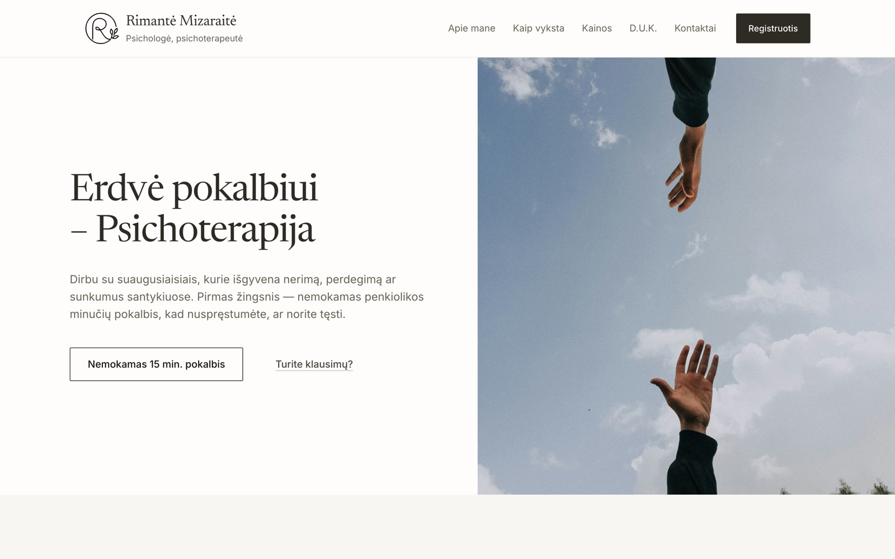
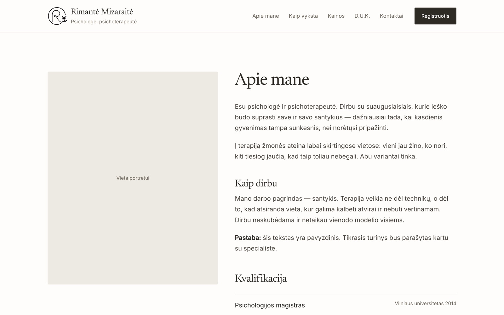
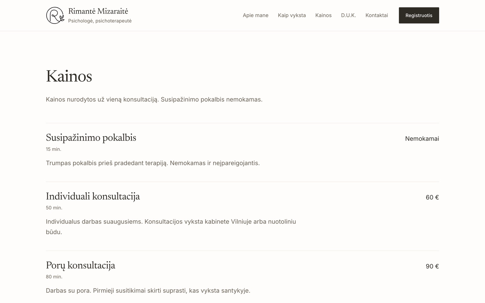
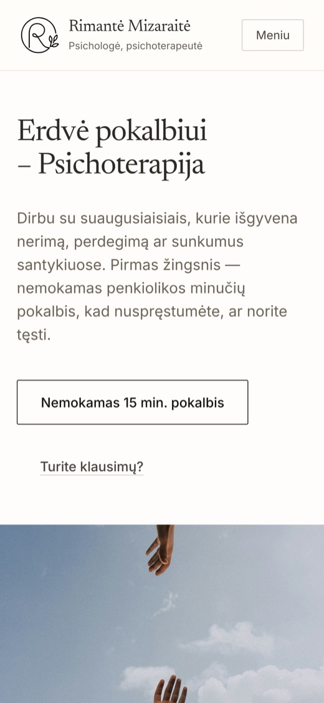

# Rimantė Mizaraitė: psychotherapist website

The website of a psychologist and psychotherapist in private practice in Vilnius. I designed and built it for the client in August 2026. The site's content is in Lithuanian.

**Live:** https://rimante-mizaraite.pijauk.workers.dev



## What it does

- **Pages:** home, about, how sessions work, prices, FAQ, contacts and privacy policy, all with Lithuanian URLs.
- **The client edits the site without a developer.** Texts, prices, FAQ, photos and the logo are managed in [Keystatic](https://keystatic.com) at `/keystatic`. Every save becomes a commit in this repository, and Cloudflare rebuilds the site.
- **Booking:** the free 15-minute intro call is booked through a Cal.com pop-up.
- **Fast and simple:** public pages are static HTML with almost no JavaScript. The menu and the FAQ use native `<details>` elements. Pages carry SEO metadata and structured data (JSON-LD).

| About | Prices | Mobile |
|---|---|---|
|  |  |  |

## Designed around the rules

Lithuanian law strictly limits advertising of healthcare services. So the site has no testimonials, reviews or ratings, and no images that could look like patients. It shows only the therapist, the consulting room and quiet detail shots.

The design rules:
- light mode only, with warm neutral colours instead of clinical blue
- serif headings and sans-serif body text, loaded with Lithuanian characters (`latin-ext`)
- body text 18px or larger, at most 68 characters per line
- one main call to action everywhere: the free intro call

All the rules are in [CLAUDE.md](CLAUDE.md).

## Built with

Astro 7 (static output) · Tailwind CSS 4 · Keystatic CMS with Keystatic Cloud · Cloudflare Workers · Cal.com

Two decisions worth knowing about:

- **Content is read through Astro content collections, not the Keystatic Reader API.** Under the Cloudflare adapter, the Reader silently returns empty data during prerendering.
- **Everything is prerendered except `/keystatic`.** That route is server-rendered, so the editor works on the live site.

## Run it locally

```bash
npm install
npm run dev
```

- Site: http://localhost:4321
- CMS: http://localhost:4321/keystatic

Locally, Keystatic runs in local mode: edits are written straight to `src/content/`. Deploying and switching to Keystatic Cloud are covered in [docs/DEPLOY.md](docs/DEPLOY.md) and [docs/SETUP-CLOUD.md](docs/SETUP-CLOUD.md).

## Project structure

```
src/
  content/            content edited in Keystatic
    settings/         contacts, hours, address, booking link
    pages/            page content (JSON + Markdoc)
    services/         session types and prices
    faq/              FAQ entries
  content.config.ts   Astro collections: how content is read
  layouts/Base.astro  page shell, SEO, JSON-LD
  components/         header, footer, buttons, sections
  pages/              routes (Lithuanian URLs)
  styles/global.css   design tokens
keystatic.config.ts   CMS schema, with Lithuanian labels for the client
```

| Route | Page |
|---|---|
| `/` | Pradžia (home) |
| `/apie` | Apie mane (about) |
| `/kaip-vyksta` | Kaip vyksta konsultacijos (how sessions work) |
| `/kainos` | Kainos (prices) |
| `/duk` | D.U.K. (FAQ) |
| `/kontaktai` | Kontaktai (contacts) |
| `/privatumo-politika` | Privatumo politika (privacy policy) |
| `/keystatic` | Content editor |
